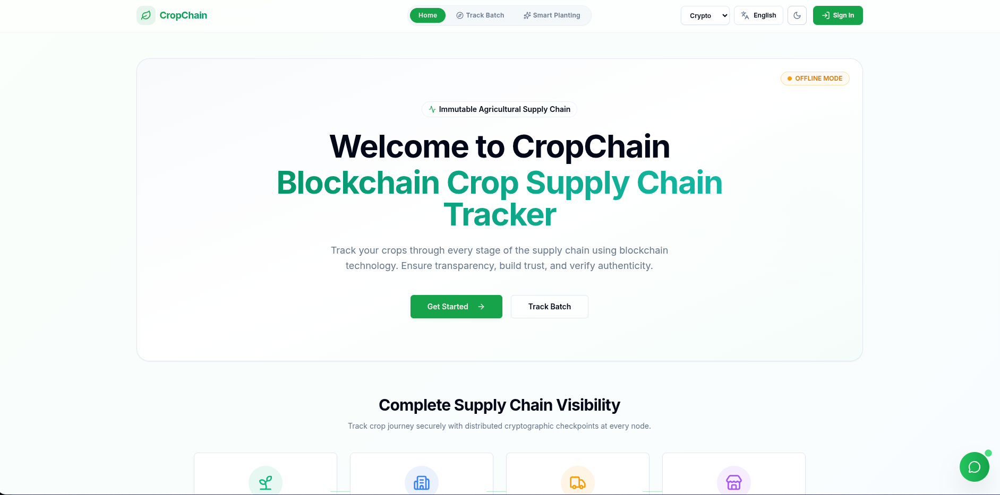
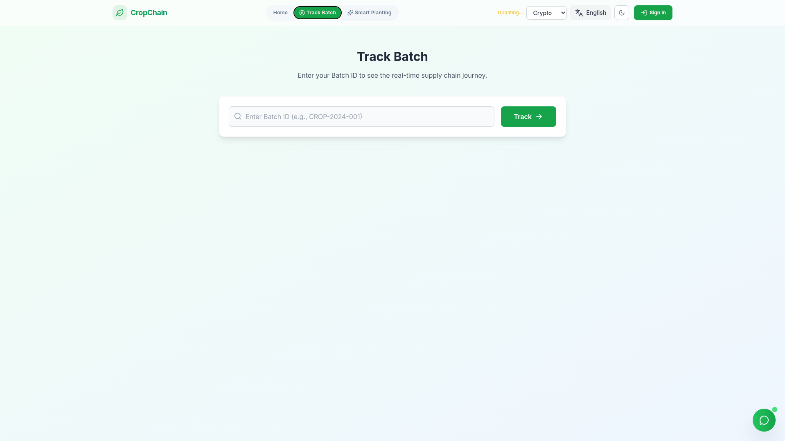
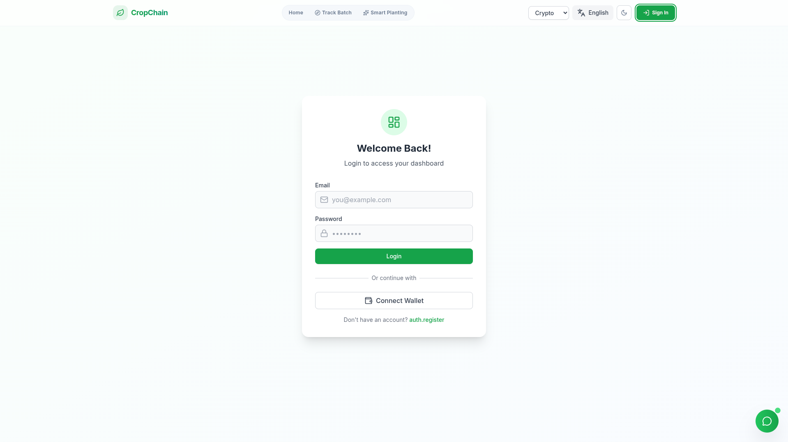
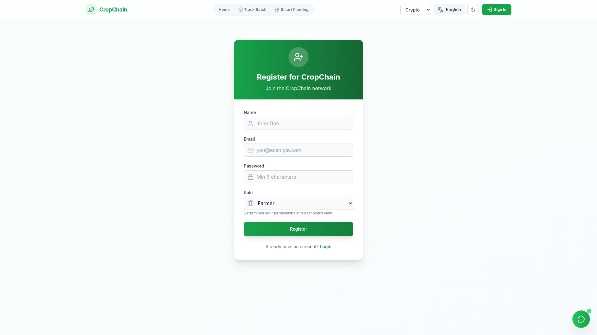
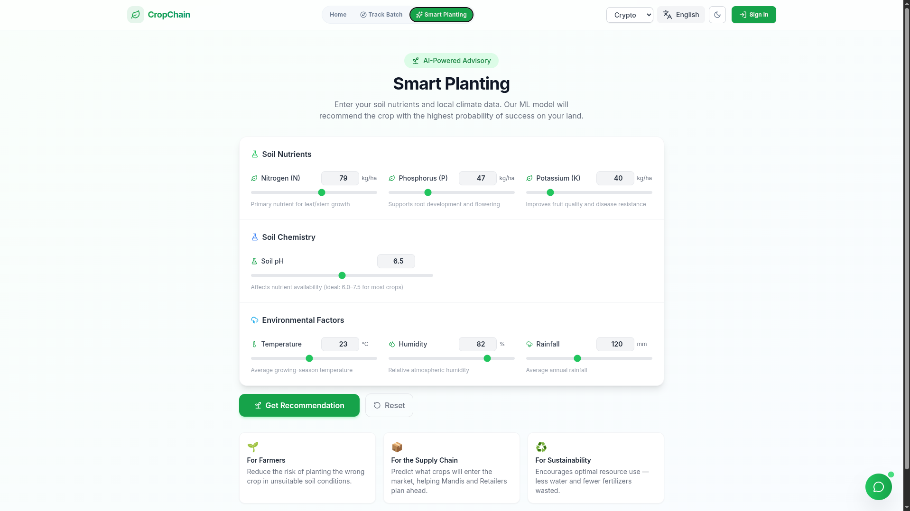
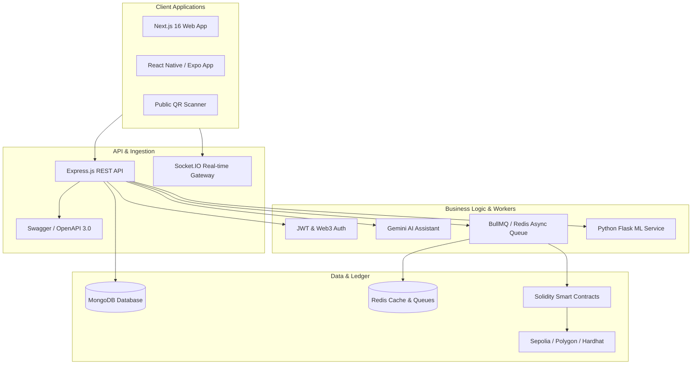
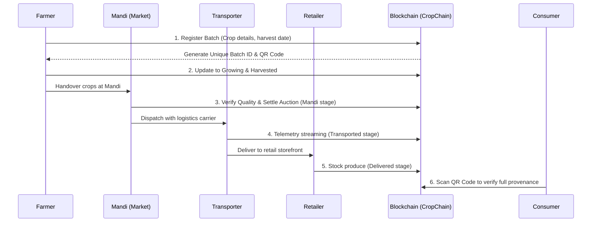

# CropChain - Blockchain Crop Supply Chain Tracker

[](https://github.com/Nitya-003/CropChain/actions/workflows/ci.yml)
[](https://opensource.org/licenses/Apache-2.0)
[](https://soliditylang.org/)
[](https://nextjs.org/)
[](https://nodejs.org/)
[](https://python.org/)
[](https://www.docker.com/)

<p align="center">
  
  
  
  
</p>

CropChain is a decentralized agricultural supply chain provenance tracking platform built with blockchain technology. From farm to fork, every step of a crop batch journey is recorded immutably on-chain—providing verifiable transparency, automated cold-chain quality tracking, decentralized Mandi produce auctions, and deep consumer trust.

---

## 🌐 Live Deployment

The system is deployed and active across production environments:

- **Frontend Application (Vercel)**: [cropchain.sonusid.in](https://cropchain.sonusid.in)
- **Backend API (AWS EC2)**: [cropapi.sonusid.in](https://cropapi.sonusid.in)
- **API Health Status**: [cropapi.sonusid.in/api/health](https://cropapi.sonusid.in/api/health)
- **Interactive Swagger Documentation**: [cropapi.sonusid.in/api/docs](https://cropapi.sonusid.in/api/docs)
- **Smart Contract (Sepolia Testnet)**: [`0x2c79F3f6b448270ADF667CA5d23d23feC4d15Fa4`](https://sepolia.etherscan.io/address/0x2c79F3f6b448270ADF667CA5d23d23feC4d15Fa4)

---

## 📸 UI Previews & Screenshots

|           Home Page           |          Track Batch Journey          |
| :---------------------------: | :-----------------------------------: |
|  |  |

|     User Login & Web3 Auth      |         Account Registration          |
| :-----------------------------: | :-----------------------------------: |
|  |  |

|    Pricing & Subscription Plans     |
| :---------------------------------: |
|  |

---

## ✨ Features

### Core Functionality

- **Immutable Provenance Tracking**: Every crop batch journey is cryptographically recorded on Ethereum / Polygon smart contracts.
- **Dynamic QR Code Generation**: Unique QR codes generated for every batch allow instant provenance lookup and verification for consumers.
- **6-Stage Sequential Lifecycle**: Enforces strict transitions: `Registered` → `Growing` → `Harvested` → `Quality Checked` → `Transported` → `Delivered`.
- **Role-Based Access Control**: Tailored dashboards and granular permissioning for **Farmers**, **Mandi (Markets)**, **Transporters**, **Retailers**, and **Administrators**.
- **Decentralized Produce Auctions**: Transparent bidding system for Mandis and buyers with high-precision financial handling (`Decimal128`).
- **AI-Powered Chat Assistant**: Integrated Gemini (@google/generative-ai) chatbot with context-aware batch lookup, natural language queries, and streaming responses.
- **IoT Cold-Chain Telemetry**: Ingestion endpoints for temperature, humidity, and location tracking with automated spoilage detection and alert generation.
- **EIP-2771 Gasless Meta-Transactions**: Forwarder contracts allow farmers and stakeholders to log supply chain data without paying direct gas fees.
- **Offline-First Resilience**: Local data caching with automatic synchronization when internet connectivity is restored.

### User Experience & Design

- **Apple-Grade Modern UI**: High-polish aesthetic using Tailwind CSS and Framer Motion micro-interactions.
- **Responsive Across Devices**: Fully optimized for desktop, tablet, and mobile browsers, plus a companion React Native (Expo) mobile app.
- **Real-Time Interactive Timelines**: Visual progress tracker with stage delay detection, hover tooltips, and on-chain transaction hash links.
- **Interactive API Documentation**: Live Swagger/OpenAPI 3.0 explorer available at `/api/docs`.

---

## 🏛️ System Architecture



### Supply Chain Lifecycle Flow



---

## 🛠️ Technology Stack

| Layer              | Technologies                                                                             |
| ------------------ | ---------------------------------------------------------------------------------------- |
| **Frontend**       | Next.js 16, React 19, TypeScript, Tailwind CSS, Framer Motion, Lucide Icons, Leaflet GIS |
| **Mobile**         | React Native, Expo SDK 52, NativeWind, Expo Router, VisionCamera QR Scanner              |
| **Backend**        | Node.js 20+, Express.js, Mongoose, Ethers.js v6, BullMQ, Redis, Socket.IO, Winston       |
| **AI & ML**        | Google Gemini SDK (`@google/generative-ai`), Python 3.11, Flask, Scikit-learn, Gunicorn  |
| **Blockchain**     | Solidity ^0.8.24, Hardhat, OpenZeppelin Contracts v5, EIP-2771 Forwarders                |
| **DevOps & Cloud** | Docker, Docker Compose, AWS EC2, AWS Secrets Manager, GitHub Actions CI/CD, Terraform    |

---

## 📁 Repository Structure

```text
CropChain/
├── backend/                   # Node.js + Express REST API server
│   ├── config/                # Database and Redis connections
│   ├── constants/             # Stage mappings and permissions
│   ├── controllers/           # Route controllers (batch, auth, lifecycle, auction, AI)
│   ├── middleware/            # JWT auth, CSRF, rate limiters, validators
│   ├── models/                # Mongoose schemas (Batch, User, Auction, Verification)
│   ├── routes/                # Express API routes with OpenAPI annotations
│   ├── services/              # Blockchain worker, AI service, activity logger
│   └── tests/                 # Jest integration and unit test suite
├── frontend/                  # Next.js 16 application
│   ├── src/app/               # App Router pages (batches, track, auth, auctions)
│   ├── src/components/        # UI components (lifecycle tracker, QR scanner, modals)
│   └── public/                # Static assets, icons, manifest
├── smart-contracts/           # Solidity contracts & Hardhat environment
│   ├── contracts/             # CropChain.sol, Forwarder.sol, DAO governance
│   ├── scripts/               # Deployment and migration scripts
│   └── test/                  # Chai / Hardhat smart contract tests
├── ml-service/                # Python Flask service for crop quality & yield loss
│   ├── app.py                 # Flask API with endpoints for image diagnosis
│   ├── weather_pipeline.py    # Climate anomaly & yield loss risk engine
│   └── requirements.txt       # Python dependencies
├── mobile/                    # React Native / Expo companion mobile app
│   ├── app/                   # Expo Router tabs and batch screens
│   └── src/                   # Hooks, contexts, and offline sync store
├── infrastructure/            # Terraform AWS provisioning templates
├── docs/                      # Architectural guides, checklists, and specs
├── ScreenShots/               # Platform UI screenshots
├── docker-compose.yml         # Local multi-service orchestration
└── deploy-aws.sh              # Production AWS CloudFormation deployment script
```

---

## 🚀 Getting Started

You can run CropChain locally using either **Docker Compose** (recommended for full-stack) or by **running services manually**.

### Prerequisites

Ensure you have the following installed:

- [Git](https://git-scm.com/)
- [Docker](https://docs.docker.com/get-docker/) & [Docker Compose](https://docs.docker.com/compose/) (for Docker setup)
- [Node.js](https://nodejs.org/) (v20+ recommended) and `npm`
- [Python](https://www.python.org/) 3.11+ (if running ML service manually)
- [MetaMask](https://metamask.io/) browser extension (for Web3 wallet interactions)

---

### Option A: Quickstart with Docker Compose (Recommended)

1. **Clone the repository:**

   ```bash
   git clone https://github.com/Nitya-003/CropChain.git
   cd CropChain
   ```

2. **Set up the environment configuration:**

   ```bash
   cp .env.example .env
   ```

3. **Start the complete stack:**

   ```bash
   docker compose up --build
   ```

   This launches:
   - **Frontend**: `http://localhost:3000`
   - **Backend API**: `http://localhost:3001`
   - **Interactive API Docs**: `http://localhost:3001/api/docs`
   - **ML Service**: `http://localhost:5001`
   - **Hardhat Blockchain Node**: `http://localhost:8545`
   - **MongoDB Database**: `mongodb://localhost:27017/cropchain`

4. **Deploy smart contracts to the local Hardhat container:**

   ```bash
   docker compose exec hardhat npx hardhat run scripts/deploy.js --network localhost
   ```

5. **Stop the services:**
   ```bash
   # Stop containers
   docker compose down

   # Stop containers and wipe database volumes
   docker compose down -v
   ```

---

### Option B: Manual Local Development Setup

If you prefer running services directly on your host machine:

#### 1. Clone & Setup Environment

```bash
git clone https://github.com/Nitya-003/CropChain.git
cd CropChain

cp .env.example .env
cp backend/.env.example backend/.env
```

#### 2. Run Local Hardhat Blockchain Node

```bash
cd smart-contracts
npm install
npx hardhat node
```

In a separate terminal, deploy contracts locally:

```bash
cd smart-contracts
npx hardhat run scripts/deploy.js --network localhost
```

#### 3. Start Backend API Server

```bash
cd backend
npm install
npm run dev
```

Backend runs at `http://localhost:3001` (Health: `http://localhost:3001/api/health`).

#### 4. Start Frontend Application

```bash
cd frontend
npm install
npm run dev
```

Frontend runs at `http://localhost:3000`.

#### 5. Start ML Service (Optional)

```bash
cd ml-service
python3 -m venv venv
source venv/bin/activate
pip install -r requirements.txt
python3 app.py
```

ML Service runs at `http://localhost:5001`.

---

## ⚙️ Environment Configuration

### Key Backend Variables (`backend/.env`)

| Variable                  | Description                                              | Default / Example                            |
| ------------------------- | -------------------------------------------------------- | -------------------------------------------- |
| `PORT`                    | API server listening port                                | `3001`                                       |
| `NODE_ENV`                | Application environment (`development` / `production`)   | `development`                                |
| `MONGODB_URI`             | MongoDB connection string                                | `mongodb://localhost:27017/cropchain`        |
| `JWT_SECRET`              | Signing secret for access tokens (min 16 chars)          | `openssl rand -hex 32`                       |
| `JWT_REFRESH_SECRET`      | Signing secret for refresh tokens (must differ)          | `openssl rand -hex 32`                       |
| `AUDIT_EVENT_HMAC_SECRET` | Secret for audit log hash-chain integrity (min 32 chars) | `openssl rand -hex 32`                       |
| `INFURA_URL`              | RPC endpoint URL for Ethereum / Polygon testnet          | `https://sepolia.infura.io/v3/YOUR_KEY`      |
| `CONTRACT_ADDRESS`        | Deployed address of `CropChain.sol`                      | `0x2c79F3f6b448270ADF667CA5d23d23feC4d15Fa4` |
| `GEMINI_API_KEY`          | Google AI Studio key for intelligent assistant           | Optional                                     |
| `ML_API_KEY`              | Shared authentication secret for ML Service              | `openssl rand -hex 32`                       |

---

## 📖 API Reference & Documentation

CropChain features interactive Swagger/OpenAPI documentation. When the backend is running, navigate to:

👉 **`http://localhost:3001/api/docs`** (or [cropapi.sonusid.in/api/docs](https://cropapi.sonusid.in/api/docs))

### Core Endpoints Overview

| Method  | Endpoint                     | Description                                                   | Auth Required    |
| ------- | ---------------------------- | ------------------------------------------------------------- | ---------------- |
| `GET`   | `/api/health`                | Service health status and database connectivity               | No               |
| `POST`  | `/api/auth/register`         | Register new user (farmer, mandi, transporter, retailer)      | No               |
| `POST`  | `/api/auth/login`            | Authenticate user and receive JWT session cookies             | No               |
| `POST`  | `/api/auth/refresh`          | Refresh expired access token                                  | No               |
| `POST`  | `/api/auth/logout`           | Terminate session and clear authentication cookies            | Yes              |
| `POST`  | `/api/batches`               | Create a new agricultural crop batch                          | Farmer / Admin   |
| `GET`   | `/api/batches`               | Query and filter crop batches with pagination                 | Yes              |
| `GET`   | `/api/batches/public/:id`    | Public provenance tracking data for consumers                 | No               |
| `GET`   | `/api/batches/:id/lifecycle` | Get current 6-stage lifecycle progress and history            | Yes              |
| `PATCH` | `/api/batches/:id/lifecycle` | Advance lifecycle stage (`Growing`, `Transported`, etc.)      | Role-checked     |
| `POST`  | `/api/batches/relay-meta-tx` | Relay EIP-2771 gasless transaction to the blockchain          | Yes              |
| `POST`  | `/api/ai/chat`               | Send queries to Gemini AI assistant (SSE streaming supported) | Yes              |
| `POST`  | `/api/iot/:batchId`          | Ingest cold-chain temperature and humidity sensor readings    | Yes              |
| `POST`  | `/api/auctions`              | Create an active produce auction for a batch                  | Farmer / Admin   |
| `POST`  | `/api/auctions/:id/bid`      | Place a bid on a produce auction                              | Registered buyer |

---

## 🧪 Testing Suite

Run automated tests across the codebase:

```bash
# Backend unit and integration tests (Jest)
cd backend
npm test -- --watchAll=false

# Frontend tests (Vitest)
cd frontend
npm test

# Smart contract tests (Hardhat & Chai)
cd smart-contracts
npx hardhat test

# ML service verification
cd ml-service
python3 -m unittest test_vision.py
```

---

## 🔐 Security & Key Management

### Local Development

For local testing, place a dedicated development private key in `.env`:

```env
PRIVATE_KEY=0x...your_local_dev_key...
```

> ⚠️ **Warning:** Never use real funds or commit private keys to version control.

### Production Deployment

In production, plaintext private keys are prohibited. The server fetches credentials from **AWS Secrets Manager**:

1. Store the secret in AWS Secrets Manager:
   - **Secret Name:** `cropchain/blockchain-private-key`
   - **Secret Value (JSON):**
     ```json
     { "private_key": "0x...your_production_key..." }
     ```

2. Grant your EC2 instance or ECS task role permissions for `secretsmanager:GetSecretValue`.

3. Configure runtime variables on the host:

   ```env
   NODE_ENV=production
   AWS_SECRET_ARN=arn:aws:secretsmanager:REGION:ACCOUNT:secret:cropchain/blockchain-private-key
   AWS_REGION=us-east-1
   ```

4. Do **not** supply `PRIVATE_KEY` directly—the server validates this on startup and refuses to start if exposed as plaintext.

---

## 🗺️ Roadmap

- [x] **Phase 1: Core Foundation**
  - Blockchain provenance logging on Polygon/Ethereum
  - Dynamic QR code generation and consumer verification
  - Multi-role dashboards (Farmer, Mandi, Transporter, Retailer, Admin)
  - 6-Stage sequential crop lifecycle tracking
  - AI chatbot assistant powered by Gemini

- [x] **Phase 2: Platform Expansion**
  - Real-time IoT sensor telemetry ingestion and cold-chain monitoring
  - Mandi produce auctions with Decimal128 financial calculations
  - EIP-2771 gasless meta-transactions via relayer
  - OpenAPI 3.0 specification with interactive Swagger UI
  - React Native (Expo) mobile application

- [ ] **Phase 3: Next Horizons**
  - Decentralized storage on IPFS/Filecoin for media inspection records
  - Automated IoT quality oracles with Chainlink Functions
  - Multi-regional language localization (Hindi, Marathi, Punjabi, Telugu)
  - Carbon footprint accounting and green certification dNFTs

---

## 🤝 Contributing

We welcome contributions from the open-source community!

1. Fork the repository on GitHub.
2. Create a descriptive feature branch:
   ```bash
   git checkout -b feat/your-feature-name
   ```
3. Commit your changes following [Conventional Commits](https://www.conventionalcommits.org/):
   ```bash
   git commit -m "feat(batches): add batch export to PDF"
   ```
4. Push to your fork:
   ```bash
   git push origin feat/your-feature-name
   ```
5. Open a Pull Request against `main`.

Please review our [Contributing Guidelines](CONTRIBUTING.md), [Code of Conduct](CODE_OF_CONDUCT.md), and [Security Policy](SECURITY.md) before submitting.

---

## 📄 License

This project is licensed under the **Apache License 2.0** — see the [LICENSE](LICENSE) file for details.

---

## 💖 Acknowledgments

- [OpenZeppelin](https://www.openzeppelin.com/) for battle-tested smart contract libraries.
- [Ethereum](https://ethereum.org/) & [Polygon](https://polygon.technology/) ecosystems for decentralized ledger infrastructure.
- The open-source contributors and agricultural experts who make transparent food supply chains possible.

<p align="center">
  <b>CropChain</b> — <i>Connecting farms to forks with immutable blockchain transparency.</i>
</p>
